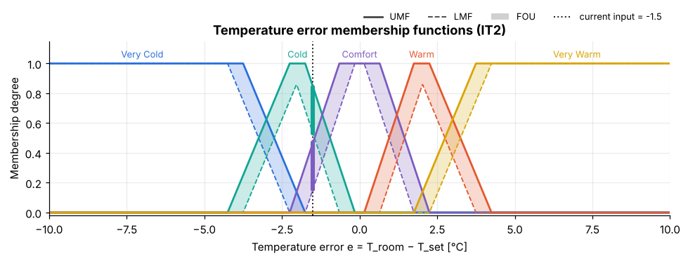
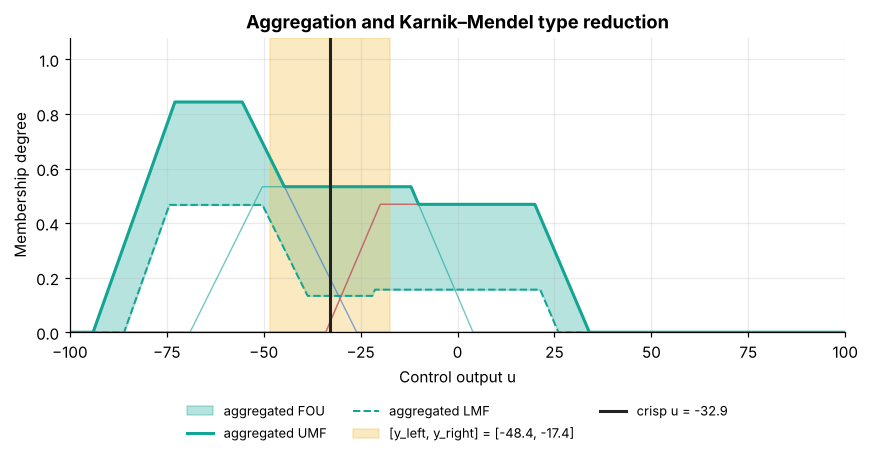
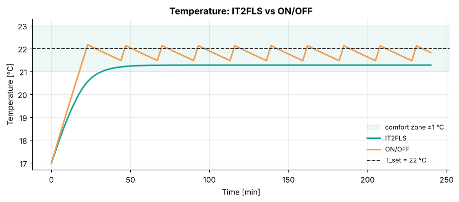
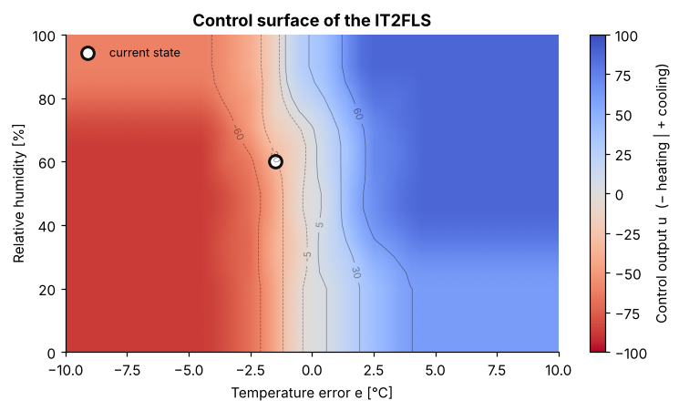

# 🌡️ Fuzzy HVAC Simulator

Symulator inteligentnego sterowania temperaturą w pomieszczeniu z użyciem **przedziałowej logiki rozmytej typu 2
(Interval Type-2 Fuzzy Logic System, IT2FLS)**. Aplikacja łączy działający regulator, symulację dynamiki pomieszczenia,
porównanie z klasycznym regulatorem ON/OFF i interaktywny panel w Streamlit. Projekt ma charakter akademicki i edukacyjny.

> To **symulator**: nie steruje żadnym fizycznym urządzeniem, a model pomieszczenia jest uproszczony (patrz „Ograniczenia”).

## Cel

* pokazać działanie IT2FLS od funkcji przynależności (UMF/LMF/FOU), przez reguły i wnioskowanie, po redukcję typu Karnika–Mendela,
* umożliwić eksperymentowanie z parametrami i natychmiastową obserwację skutków,
* porównać regulator rozmyty z ON/OFF z histerezą w tej samej symulacji.

## Technologie

Python 3.11+ (testowane na 3.12), NumPy, Pandas, Matplotlib, Streamlit, Pytest.
Kluczowe elementy IT2FLS (funkcje przynależności, wnioskowanie, algorytm KM) są **zaimplementowane własnym kodem**, bez scikit-fuzzy.

## Opis systemu Type-2

Zbiór rozmyty typu 2 ma dla każdego $x$ nie jedną wartość przynależności, lecz **przedział** $[\mathrm{LMF}(x),\mathrm{UMF}(x)]$.
Obszar między krzywymi to **Footprint of Uncertainty (FOU)**, który modeluje niepewność co do kształtu zbioru.
Wnioskowanie daje przedziałowe siły odpalenia reguł, a **type reduction** zamienia przedziałowy wynik na przedział
$[y_{left},y_{right}]$; wartość crisp to jego środek.

### Wejścia i wyjście

| | Opis | Zakres |
|---|---|---|
| Błąd temperatury | $e=T_{room}-T_{set}$; 5 zbiorów: Very Cold, Cold, Comfort, Warm, Very Warm | −10…+10 °C (wartości poza zakresem są obcinane) |
| Wilgotność | 4 zbiory: Low, Optimal, High, Very High | 0–100 % |
| Temperatura zadana | parametr użytkownika, domyślnie 22 °C | 16–30 °C |
| Wyjście $u$ | 7 zbiorów: Strong/Moderate/Gentle Heating, Neutral, Gentle/Moderate/Strong Cooling | −100…+100 |

Konwencja: $u<0$ – ogrzewanie, $u>0$ – chłodzenie, $u\approx0$ – neutralnie. $e<0$ oznacza, że jest za zimno.

### Funkcje przynależności i FOU

Zbiory to trapezy/trójkąty (w tym zbiory ramieniowe na krańcach dziedziny). UMF ma krawędzie rozsunięte o $s$, LMF zsunięte o $s$,
przy tym samym nachyleniu zboczy, dlatego $\mathrm{LMF}\le\mathrm{UMF}$ zachodzi z konstrukcji. Parametr $s$ zależy od
współczynnika szerokości FOU (suwak w Settings, 0 = system typu 1, domyślnie 1). Pełne wzory i tabele parametrów:
[`docs/mathematical_model.md`](docs/mathematical_model.md).



### Baza reguł

20 reguł (5 × 4) w jednym module `core/rule_base.py`, tabela generowana z `config/default_config.py`. Temperatura jest głównym czynnikiem,
wilgotność modyfikuje intensywność (wysoka wzmacnia chłodzenie i osłabia grzanie). W strefie komfortu sama wilgotność wywoła co najwyżej *Gentle Cooling*.
Interfejs czyta dokładnie tę samą listę, której używa silnik.

### Inferencja

Mamdani z T-normą = minimum i S-normą = maksimum. Dla reguły $l$: $f_l=\min(\underline\mu_T,\underline\mu_H)$,
$F_l=\min(\overline\mu_T,\overline\mu_H)$. Zagregowany zbiór wyjściowy: maksimum z obciętych konsekwencji (osobno dla UMF i LMF).

### Redukcja typu Karnika–Mendela

Model *center-of-sets*: każda konsekwencja jest reprezentowana przez przedział swojego centroidu $[c_l,c_r]$ (też liczony algorytmem KM).
Algorytm KM (`core/type_reduction.py`) sortuje centroidy, iteracyjnie wyznacza punkt przełączenia $k$ i oblicza
$y_{left}$ oraz $y_{right}$; wynik: $u=(y_{left}+y_{right})/2$. Poprawność jest weryfikowana testem względem przeglądu zupełnego $2^N$ wyborów brzegów.



### Symulacja pomieszczenia

$\dfrac{dT}{dt}=\dfrac{T_{out}-T}{\tau}+P(u)$, $P(u)=r_h\max(-u,0)/100-r_c\max(u,0)/100$ (czas w minutach).
Krok jest rozwiązywany dokładnie (całkowanie wykładnicze), więc symulacja jest stabilna dla każdego kroku $\Delta t$.
Konfigurowalne: temperatura początkowa, zadana i zewnętrzna, czas, krok, $\tau$, siła grzania i chłodzenia, opcjonalne zakłócenia (z ziarnem; domyślnie wyłączone, symulacja deterministyczna).

### Regulator ON/OFF

Z pamięcią stanu i histerezą $h$: grzanie włącza się przy $T\le T_{set}-h$ i wyłącza przy $T\ge T_{set}$; chłodzenie symetrycznie.
Pracuje w tej samej symulacji, z mocą $|u|=100$.

### Metryki

MAE, RMSE, czas osiągnięcia strefy komfortu, czas ustalenia (settling time), overshoot, undershoot, liczba znaczących zmian sterowania
oraz **energy proxy** $=\sum|u|/100\cdot\Delta t$. Energy proxy to uproszczony wskaźnik intensywności sterowania,
**nie** zużycie energii w kWh.

### Przykładowy wynik (scenariusz domyślny)

$T_0=17$ °C, $T_{set}=22$ °C, $T_{out}=12$ °C, wilgotność 50 %, 240 min, $\Delta t=1$ min, histereza 0.5 °C, strefa komfortu ±1 °C
(wygenerowane `scripts/generate_figures.py`):

| Metryka | IT2FLS | ON/OFF |
|---|---|---|
| MAE [°C] | 0.97 | 0.44 |
| RMSE [°C] | 1.23 | 0.94 |
| Time to comfort [min] | 33 | 18 |
| Overshoot / undershoot [°C] | 0.00 / 0.00 | 0.17 / 0.53 |
| Zmiany sterowania | 0 | 19 |
| Energy proxy | 46.2 | 50.0 |

Regulator rozmyty działa płynnie (bez przełączania i przeregulowania), ale jako regulator typu proporcjonalnego ustala się z niewielkim
uchybem ustalonym (ok. 0.7 °C poniżej wartości zadanej przy tych stratach ciepła), czego ON/OFF nie ma. Wynik zależy od parametrów scenariusza.



## Interfejs

Siedem zakładek: **Dashboard** (karty temperatury/wilgotności/zadanej z przyciskami `−`/`+`, wyjście −100…+100 ze statusem
HEATING/NEUTRAL/COOLING, aktywne reguły, krzywa odpowiedzi, heatmapa), **Membership Functions**, **Rule Base**, **Inference** (krok po kroku do KM),
**Simulation**, **Comparison** i **Settings** (szerokość FOU, histereza, strefa komfortu, wpływ niepewności).
Dostępne wykresy: funkcje przynależności (temperatura, wilgotność, wyjście) z UMF/LMF/FOU, krzywa odpowiedzi, heatmapa sterowania,
siły odpalenia, agregacja z KM, temperatura i sygnał sterujący w czasie, porównanie regulatorów, wpływ FOU.
Wszystkie dane pochodzą z silnika i symulacji.



## Instalacja i uruchomienie

```bash
python -m venv .venv && source .venv/bin/activate     # Windows: .venv\Scripts\activate
pip install -r requirements.txt
python -m streamlit run app.py
```

Wymagany Streamlit ≥ 1.50 (nowe API `width="stretch"`); leniwe zakładki wymagają nowszej wersji, a bez niej aplikacja
automatycznie wraca do zwykłych zakładek (działa wolniej).

## Testy

```bash
python -m pytest -q
```

Testy jednostkowe obejmują funkcje przynależności (LMF ≤ UMF, FOU, zakresy), bazę reguł, wnioskowanie, algorytm KM (porównanie z przeglądem zupełnym),
sterownik, symulację, ON/OFF i metryki, a także interfejs (`streamlit.testing`): przyciski `+`/`−`, granice zakresów i aktualizację wyniku.
Testy UI trwają około minuty.

Rysunki do dokumentacji: `python scripts/generate_figures.py`.

## Struktura projektu

```
app.py                      interfejs Streamlit
config/default_config.py    parametry i tabela reguł
core/                       membership_type2, variables, rule_base, inference, type_reduction,
                            controller, room_simulation, metrics, analysis
classical/                  on_off_controller
visualization/              membership_plots, inference_plots, simulation_plots, comparison_plots, style
scripts/generate_figures.py generowanie rysunków do docs/img
tests/                      testy pytest
docs/                       mathematical_model.md, architecture.md, img/
```

Szczegóły: [`docs/architecture.md`](docs/architecture.md), [`docs/mathematical_model.md`](docs/mathematical_model.md).

## Ograniczenia modelu

* Model pomieszczenia jest jednostrefowy i demonstracyjny, nieskalibrowany względem prawdziwego budynku.
* Wilgotność wpływa na decyzję tylko przez bazę reguł. Nie jest sterowana ani modelowana fizycznie (stała w symulacji).
* Wyjście to średnia centroidów, więc wartości skrajne to ok. ±87, a nie dokładnie ±100.
* Regulator IT2FLS nie ma członu całkującego, więc występuje uchyb ustalony zależny od strat ciepła.
* Energy proxy to bezwymiarowy wskaźnik intensywności sterowania, nie kWh.
* Parametry zbiorów i reguł dobrano ręcznie (nie strojono optymalizacyjnie).
* Interfejs sprawdzono automatycznie (`AppTest`) i przez uruchomienie serwera; nie był oglądany ręcznie w przeglądarce.
